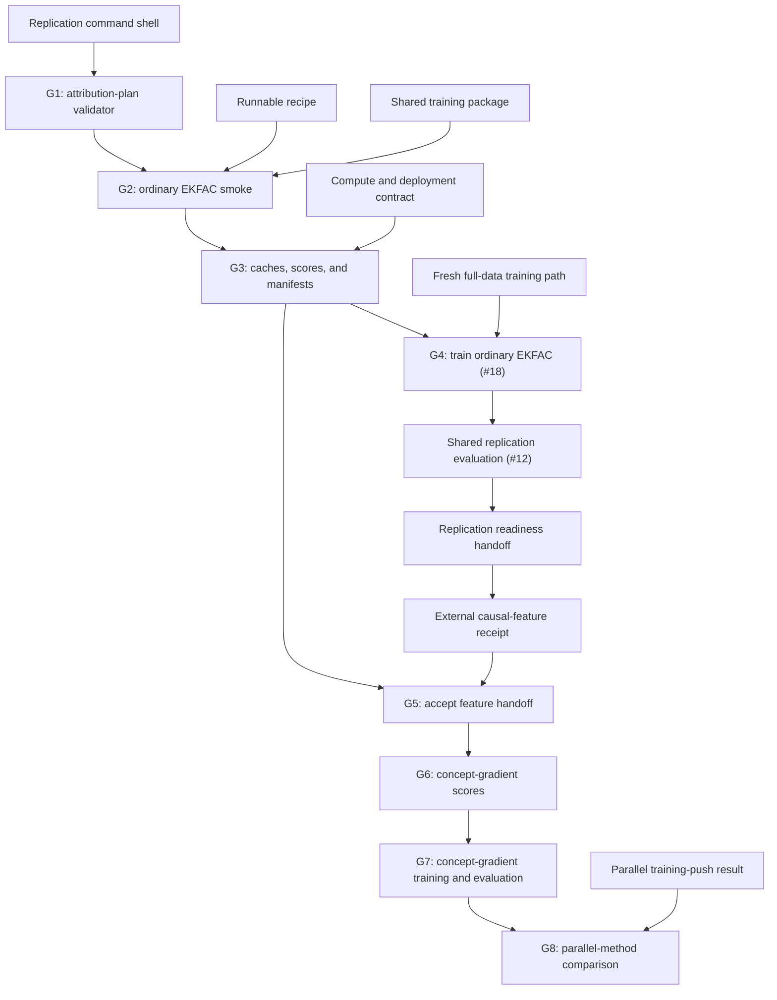

# Causal-gradient attribution roadmap

## Destination

Determine whether replacing ordinary behavior-query EKFAC with a query derived
from causally validated SAE features identifies a more removable 10% subset of
the frozen OLMo SFT sample. Validation of feelings is the primary behavior and
refusal is the positive control. This lane complements rather than replaces the
activation-based training-push selector.

The immediate checkpoint stops before SAE feature selection and
concept-selected training. The full roadmap names the later work so the causal-
gradient lane can resume from a frozen feature receipt without rediscovering
method, cache, query, retraining, or evaluation decisions.

## Current checkpoint

The G0 method contract and dependency-ordered issues 14 through 22 are
published. G1 is complete and independently verified. G2 now has a receipt-
bound public-method reconstruction plus a deterministic local CPU smoke through
real Kronfluence v1.0.1 factor fitting and pairwise scoring. Two clean runs of
committed executor `03546ac` reproduced the retained software-smoke receipt
byte-for-byte. The bounded rank-32 organism smoke and its exact executor receipt
remain open before G2 closes. One condition-multiplicity decision below remains
open; it blocks only training-manifest promotion and G4 adapter multiplicity,
not G3's shared stores or its two behavior-specific selector manifests.
G2 through G4 remain pre-feature replication work, while G5 through G8 remain
blocked on the parallel lane's accepted causal-feature receipt.

The shared backbone's recipe core and corrected B2 recovery evidence are
complete. The retained receipt proves exact all-assistant-turn masking for the
observed multi-turn shape plus deterministic checkpoint recovery. B4 shared-
data materialization and issue 9's compute-and-deployment contract remain
separate prerequisites for later full-data attribution and training.

## Fixed scientific comparison

The complete comparison has these separate selectors:

1. Source-derived dense probe.
2. Matched random removal.
3. Source-style behavior-query EKFAC.
4. Causally gated SAE training push from the parallel activation lane.
5. Causally gated concept-gradient attribution from this lane.

Every trained condition uses the same full-data source manifest, named LoRA
recipe, seed, 10% document-removal dose, token accounting, and original rubric.
No selector scores are blended.

## Owner decision required before training-manifest promotion

The roadmap currently defines separate validation and refusal query scores,
while the replication backbone counts one dense-probe, one matched-random, and
one ordinary EKFAC adapter. Those statements do not determine whether the
removal conditions target validation only or form two behavior-specific blocks.
G1 plan validation, G2 backend reconstruction, and G3's shared stores and two
behavior-specific selector manifests can continue. G3 cannot promote either
selector into a training manifest, and G4 cannot freeze adapter multiplicity,
until one of these designs is approved:

1. Train only validation-selected dense, random, and EKFAC adapters, then
   evaluate refusal as a cross-behavior outcome.
2. Train separate validation-targeted and refusal-targeted blocks, each with
   dense, EKFAC, and matched-random adapters; later causal selectors also get
   one adapter per target.

The second design is methodologically stronger because the first cannot test
whether refusal-targeted EKFAC filtering reproduces the source positive
control. It also adds three replication adapters before feature selection and
requires the backbone condition counts and issues 7, 8, 11, 12, 13, 17, and 18
to be updated.

## Phase G0: Freeze the lane contract

Publish the method spec, ownership boundary, shared artifact interfaces,
pre-feature stop, and post-feature dependency graph. Add the behavior-query
EKFAC control to replication readiness because it is source-derived work, while
keeping feature selection and concept-selected training beyond that boundary.

**Gate G0:** Repository docs and issue tickets agree that training push remains
the primary activation method and this lane owns ordinary plus concept-targeted
EKFAC.

## Phase G1: Validate a pre-feature attribution plan

Implement a fail-closed public plan validator for the shared EKFAC backend,
curvature factor store, document-gradient store, and query objectives. The
checked-in contract fixture contains schema-level-ready behavior-query
objectives and blocked concept objectives. Here, `ready` means the objective is
permitted by the plan schema; it does not claim that its scientific artifacts
exist or grant model, provider, or scheduler execution. The plan cannot enable feature selection, concept
scoring, scientific use, provider execution, or concept-selected training.

**Gate G1:** The validator reports the exact executable and blocked objectives,
emits a canonical digest over every bound identity, rejects contradictory hash
roles and boundary flags, and performs no model, provider, or scheduler action.

## Phase G2: Reconstruct ordinary behavior-query EKFAC

Recover the public source method and freeze every missing backend choice before
scores are inspected. Bind the exact on-policy completion and prompt-bank
receipts. Run a bounded real smoke through factor fitting, one document
gradient, one behavior query, a second synthetic scalar query,
inverse-curvature application, and finite scores. Record the implementation divergence if the source backend
cannot provide the required generic query seam.

**Gate G2:** One clean executor reproduces the smoke from immutable config,
artifacts, runtime, and release roles, and the same backend can accept a later
concept-activation query without changing factor semantics.

The local fixture fits factors once, reuses the same factor and training-gradient
identities for behavior-loss and synthetic scalar measurements, and proves that
only the query gradient and derived scores change. It also proves
inverse-factor application, finite scores, and repeatability. It deliberately uses empirical Fisher and float64 arithmetic for
deterministic software evidence; the bounded rank-32 smoke must still exercise
the frozen sampled-true-Fisher and low-memory production profile before this
gate is complete.

### Bounded rank-32 closure contract

The remaining G2 smoke loads the exact candidate base and rank-32 adapter and
first proves that the adapter exposes all 448 expected LoRA linear matrices.
Kronfluence then tracks only layer 0 `k_proj`'s `lora_A.default` and
`lora_B.default` matrices. This representative attention projection retains
both LoRA factor orientations; on the published OLMo adapter they have shapes
32-by-4096 and 4096-by-32, so each side still exercises one 4096-dimensional
covariance. It is a software and artifact-chain smoke, not evidence that
partial-layer scores approximate the full method.

The factor fit uses the shortest retained canonical training member, package
ordinal 17,763 (`orig_idx=51158`, 106 tokens), and the behavior query uses the
shortest retained validation completion, generation index 82 (514 tokens after
EOS reconstruction). Both are fixed by identity and content hash before model
execution. The smoke uses batch size one, one covariance example, one lambda
example, seed 42, sampled true Fisher, bfloat16 autocast, covariance, and
lambda storage, float64 eigendecomposition, iterative lambda aggregation, CPU
activation offload, null damping, rank-64 full-SVD query compression, and the
production score dtypes. Those one-example and two-module bounds are the only
deliberate departures from the full 25,007-document, 448-module profile.

Kronfluence only invokes its low-rank branch when both per-module gradient
dimensions exceed the requested rank. Every rank-32 LoRA matrix has a minimum
dimension of 32, so the frozen rank-64 setting is retained but inactive for
this candidate organism; the smoke still exercises EKFAC preconditioning and
the finite inverse-curvature score.

Two fresh executions must reproduce the score within a measured frozen
tolerance and preserve exact model, data, factor-store, training-gradient,
query-gradient, and inverse-application identities. The retained receipt grants
only local bounded-smoke execution. It cannot authorize scientific use,
scheduler or provider execution, document or feature selection, concept
scoring, or training. Even after this receipt closes G2, the
condition-multiplicity decision still blocks training-manifest promotion and
G4 adapter multiplicity, while G3's shared stores and selector manifests may
proceed.

## Phase G3: Build reusable caches and the ordinary EKFAC control

Fit and persist behavior-independent curvature factors, compute one gradient
for every canonical training example, and bind both stores to exact data and
model identities. Compute ordinary behavior-query EKFAC scores for validation
and refusal, then freeze deterministic top-10-percent manifests with complete
coverage, finite-score checks, sign conventions, and tie handling.

These are selector manifests, not training-condition decisions. Producing both
preserves the evidence needed for either owner choice above without deciding
whether G4 trains the validation selector only or both behavior-specific
selectors.

**Gate G3:** The factor and gradient stores replay by hash; every document has
one ordered score per behavior; and each ordinary EKFAC removal manifest is
immutable before training.

## Phase G4: Train and evaluate the ordinary EKFAC condition

Issue 18 trains the behavior-query EKFAC removal condition under the same named
recipe, seed, runtime, and release contract as the fresh full-data, dense-probe,
and matched-random conditions. It hands the terminal adapter to the shared
replication evaluation in issue 12; issue 18 itself has no provider-evaluation
authority. Issue 12 evaluates validation and refusal under the original rubric
and adds the result to the replication-readiness handoff.

**Gate G4:** The readiness handoff includes the ordinary EKFAC adapter and
evaluation, and reports false if its score, manifest, training, or evaluation
evidence is absent.

## Pre-feature stopping boundary

Work stops here until the parallel feature-selection lane supplies an accepted
causal-feature receipt. At this point all source-derived gradient work,
curvature computation, training gradients, ordinary EKFAC scoring, baseline
training, and baseline evaluation are complete.

## Phase G5: Accept the causal-feature handoff

Load the frozen feature and attribution-query receipt. Verify the exact
organism, SAE, hook, feature IDs, signs, weights, standardization, token and
prompt aggregation, disjoint prompt roles, and bidirectional-control evidence.
Reject a missing, partial, post-outcome, or incompatible receipt.

**Gate G5:** The concept query is fully determined without this lane selecting
a feature or changing an intervention result.

## Phase G6: Compute causal concept-gradient scores

Compute query gradients for the frozen causal feature aggregate and apply the
same inverse-curvature operator to the same document-gradient store used by the
ordinary EKFAC control. Freeze per-document scores and the top-10-percent
removal manifest for each behavior.

**Gate G6:** A comparison receipt proves that only the query gradient differs
between ordinary and concept-targeted EKFAC. Coverage, score finiteness, order,
sign, and top-k membership replay exactly.

## Phase G7: Train and evaluate the concept-gradient condition

Train the concept-gradient removal condition with the one shared recipe and
seed. Evaluate both behaviors with the original rubric. Failed or missing work
remains visible and does not authorize a new selector, dose, seed, or prompt
set.

**Gate G7:** The condition differs from the other fresh adapters only in its
frozen training manifest, and every aggregate traces to per-question evidence.

## Phase G8: Compare the parallel causal methods

Report ranking overlap, score concentration, removed-token totals, and behavior
change for ordinary EKFAC, causal concept-gradient attribution, causal
training push, dense probe, and matched random. Keep the interpretation
outcome-symmetric:

- Both causal methods succeeding suggests a concentrated causal teaching
  signal and little need for curvature.
- Only concept-gradient attribution succeeding suggests parameter dynamics
  matter beyond activation shift.
- Only training push succeeding suggests the target-response contrast is
  better matched to this SFT setting than the EKFAC approximation.
- Refusal succeeding while validation fails supports a concentrated-versus-
  distributed difference without proving why validation is distributed.

**Gate G8:** Every result claim identifies whether it comes from feature
intervention, approximate influence, finite removal retraining, or
interpretation.

## Dependency graph

## Artifact contracts

- The factor cache binds model, adapter, parameter selection, loss, fitting
  data and order, damping, precision, backend, runtime, and release identities.
- The training-gradient store binds all factor identities plus canonical
  example IDs, rendered tokens, loss masks, truncation, and reduction.
- Every query-gradient receipt binds objective kind, behavior, prompt bank,
  on-policy completions when applicable, aggregation, model, and backend.
- Every score record binds one example identity, training-gradient hash,
  query-gradient hash, factor-cache hash, sign convention, and finite value.
- Every removal manifest binds source membership, score ordering, top-k rule,
  tie handling, document count, token count, and overlap summaries.

## Verification and compute boundary

The pre-feature software path uses fixtures and a bounded real smoke. Full
factor fitting and 25,007-document scoring require the frozen compute and
deployment contract, exact executor and coordinator releases, shared-project
storage, node-local staging, resumable work units, and compute-ledger entries.
No local plan or validator acquires provider or scheduler authority.

The scientific outcome is never a software acceptance criterion. A valid
ordinary or concept-gradient run may fail to outperform random; its receipts
must still be complete and its failure must remain reportable.

## Published implementation tickets

The [causal-gradient execution spec](https://github.com/glennmatlin/mats12-concept-filtering/issues/14)
is the parent map.

1. **[Validate the pre-feature causal-gradient attribution plan](https://github.com/glennmatlin/mats12-concept-filtering/issues/15).**
   Completed at the independently verified G1 checkpoint. The offline plan
   seam is fail-closed and grants no model, provider, scheduler, or scientific
   authority.
2. **[Reconstruct and smoke-test ordinary behavior-query EKFAC](https://github.com/glennmatlin/mats12-concept-filtering/issues/16).**
   Public-source reconstruction and the deterministic local Kronfluence smoke
   are complete with a retained receipt from clean executor `03546ac`. The
   bounded rank-32 organism score smoke and its exact executor receipt remain
   open.
3. **[Build reusable EKFAC caches and ordinary control manifests](https://github.com/glennmatlin/mats12-concept-filtering/issues/17).**
   Deliver frozen factors, per-document gradients, scores, and top-10-percent manifests.
4. **[Train the ordinary behavior-query EKFAC removal control](https://github.com/glennmatlin/mats12-concept-filtering/issues/18).**
   Deliver matched training, then hand the terminal adapter to issue 12 for
   original-rubric evaluation before readiness.
5. **[Accept the causal-feature handoff for concept-gradient queries](https://github.com/glennmatlin/mats12-concept-filtering/issues/19).**
   Verify the parallel lane's frozen causal-feature receipt without selecting features here.
6. **[Score causal Concept Influence and freeze removal manifests](https://github.com/glennmatlin/mats12-concept-filtering/issues/20).**
   Change only the query gradient and reuse the ordinary EKFAC stores.
7. **[Train and evaluate the causal concept-gradient condition](https://github.com/glennmatlin/mats12-concept-filtering/issues/21).**
   Deliver the one-seed, one-dose matched condition.
8. **[Compare causal-gradient attribution with training push](https://github.com/glennmatlin/mats12-concept-filtering/issues/22).**
   Report the two causal methods separately against the replication controls.
