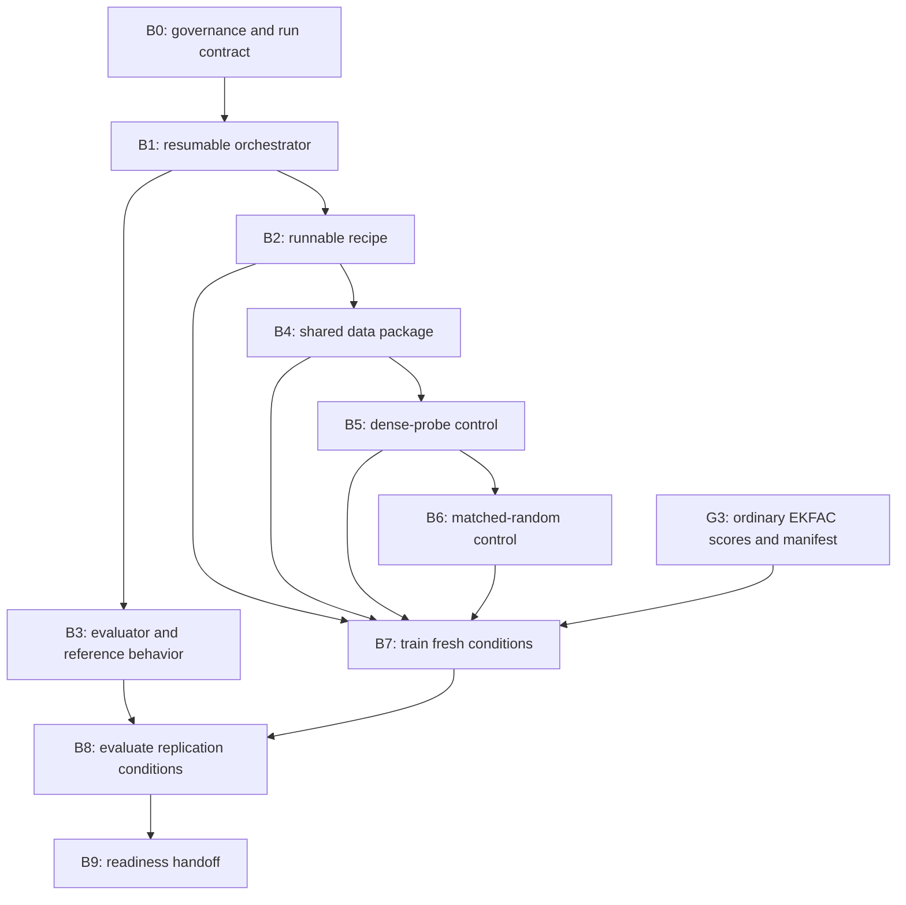

# Replication backbone roadmap: ready for SAE feature selection

## Destination

Produce a complete, receipt-bound replication backbone for validation of
feelings and the refusal positive control. The terminal state is a readiness
handoff after the fresh full-data, dense-probe-removal, matched-random-removal,
and behavior-query-EKFAC-removal conditions have been trained and evaluated,
with every shared input and command needed by the later concept-selected arm
already frozen.

The roadmap stops before SAE feature selection. Causal SAE interventions,
concept scoring, and concept-selected training are the next scientific phase,
not part of this backbone.

## Governing decisions

- The approximately 20 active hours in the application sketch are an effort
  estimate, not a clock, budget, acceptance gate, or reason to omit work.
- The public rank-32 adapter is a named reconstruction candidate while the
  source study's rank-64 adapter and producing recipe remain unavailable.
- A fresh full-data control is required. All fresh conditions use one frozen
  named reconstruction recipe and one seed, so data removal is the only
  between-condition change.
- The frozen scientific comparison uses validation of feelings, refusal, one
  10% removal dose, the source-derived dense-probe and behavior-query EKFAC
  controls, matched random, and the original rubric evaluation.
- The backbone includes shared preprocessing and automation even when a later
  SAE arm will consume it. The readiness handoff may not defer an unresolved
  recipe, data, evaluation, compute, or provenance decision.

## Scope audit against the source study

The motivating study trains a rank-64 LoRA on a stratified 1% SFT sample,
scores roughly 25,000 documents with several attribution families, removes the
top 10% or 25%, retrains from the mid-train base, and compares with equal-size
random removal. This backbone retains only the source-derived pieces required
by the frozen replication-plus-one-change design: the organism, full-data
control, dense probe, behavior-query EKFAC, 10% removal, random control,
retraining, and original behavior evaluation.

Complete but unrelated source-study branches remain outside this roadmap:
LLM-judge selection, other activation selectors, the 25% dose, sequential
filtering, narrow-domain training, add-back, debolding, pre-train variants, the
emergent-misalignment testbed, extra behaviors, seeds, or evaluations. They are
separate experiments rather than prerequisites for the novel boundary.

The [causal-gradient attribution roadmap](2026-08-15-causal-gradient-attribution-roadmap.md)
adds ordinary behavior-query EKFAC as a required source-derived control and
prepares shared factors and training gradients for a later causally gated
concept query. It does not replace the activation-based training-push selector.

## Current state

The repository has a pinned public rank-32 organism, exact 25,007-row sample
identity, observed adapter recipe evidence, a complete 201-response generation
bank, exact offline reconstruction of all 201 evaluator requests and archived
scores, and static plus one-token functional compatibility evidence for the
published layer-16 SAE. It also has a named runnable rank-32 recipe. Its bounded
checkpoint-resume receipt is corrected, retained, and replay-verified after
real-data inspection exposed an untested multi-turn assistant-mask case. These
are reconstruction and software artifacts, not a full-data training execution
or scientific result. The content-free B4 training-data package is also
materialized and replay-verified from the clean committed executor: all 25,007
rows have stable identities and token-accounting records, with no overlength
drops. Base responses and the shared activation-contract smoke remain open, so
Gate B4 is not complete.

The issue 9 compute slice now has a fail-closed seven-stage Phoenix planner, a
complete synthetic no-submit proof, named release roles, shared and node-local
storage rules, retry and checkpoint policy, and append-only compute ledgers.
The production contract reports 69 exact blockers and derives no output
releases while any remain. Live Phoenix account and storage discovery, exact
deployment, command-smoke receipts, missing executor artifacts, upstream control
receipts, the owner condition-multiplicity decision, exact work-unit mappings,
and measured resource sizing remain open, so issue 9 is not complete and
scheduler submission is still prohibited.

The major open seams are accepted provider scoring, shared response and
activation inputs beyond the frozen training package, production compute inputs
and deployment, dense-probe and EKFAC reconstruction, matched removal manifests,
fresh training, baseline evaluation,
and end-to-end orchestration. Gate R2 remains rejected until its proposed scoring
policy is accepted and executed successfully.

## Terminal contract

The backbone is complete only when one machine-readable readiness receipt
proves all of the following:

1. The exact executor, coordinator, input-producer, model, tokenizer, dataset,
   prompt, evaluator, recipe, seed, and removal-manifest identities are bound.
2. The full-data, dense-probe-removal, matched-random-removal, and behavior-
   query-EKFAC-removal adapters have terminal training receipts under the same
   recipe, with only the data manifest differing.
3. Every completed adapter has per-question validation and refusal scores from
   the frozen evaluator, plus failure-visible aggregates and bootstrap
   intervals over questions.
4. Shared prompt-response pairing, token accounting, base-response generation,
   activation extraction, EKFAC factors and training gradients, resumption, and
   artifact schemas are executable from frozen configs rather than unwritten
   operator knowledge.
5. The status command reports `ready_for_sae_feature_selection`; it reports
   false if any receipt, release role, artifact hash, condition, score, or
   divergence acknowledgement is absent.

## Execution stages

### B0. Freeze governance and the run contract

Replace timer language with advisory estimates, record the novel boundary,
accept or replace the closed Gate R2 scoring proposal, and freeze the allowed
provider and compute side effects before an unattended run. Create the
authority ledger, compute ledger, run identifier, immutable config identities,
and complete release-role tuple for every side-effecting stage.

**Gate B0:** No owner decision, mutable revision, unresolved resource value, or
implicit side effect remains in the unattended path.

### B1. Build the resumable backbone orchestrator

Expose one command family that can plan the DAG, report material status,
execute the next unblocked stage, and verify the terminal receipt. Every stage
must be idempotent, exclusive-write, fail closed on upstream drift, and resume
from verified receipts without repeating an expensive side effect.

The intended interface is:

```text
concept-filtering backbone plan   --config <frozen-config>
concept-filtering backbone status --config <frozen-config>
concept-filtering backbone run    --config <frozen-config> --through <stage>
concept-filtering backbone verify --config <frozen-config>
```

`plan` and `status` are read-only. `run` may call a provider or submit compute
only when the frozen config and authority ledger explicitly enable that stage.
`verify` reconstructs the readiness receipt from durable evidence.

**Gate B1:** A fixture DAG reaches readiness, resumes after interruption, and
rejects missing, duplicated, stale, reordered, or self-contradictory evidence.

### B2. Freeze and smoke-test the named training reconstruction

Convert the observed rank-32 evidence into a runnable recipe without claiming
that unavailable source settings were recovered. Freeze LoRA targets and rank,
optimizer, configured scheduler, learning rate, warmup, effective batch,
accumulation, seed, precision, maximum sequence length, truncation, packing,
shuffle/data order, chat template, loss mask, checkpoint cadence, and resume
semantics. Record every source-supported field and every reconstruction choice.

Run a bounded training smoke that covers a source-contract-bound synthetic
shape fixture, the pinned public chat template, overlength dropping, packing,
two distinct ordered batches, adapter checkpoint writing, a persisted data
cursor, resume, and a deterministic post-resume comparison. Full 25,007-row
loading and distributed bfloat16 topology remain B4 and compute-executor gates.

**Gate B2:** A clean executor can train, checkpoint, resume, and emit a terminal
receipt using only frozen inputs. The reusable recipe-core identity is separate
from smoke authority and remains identical for the fresh full-data,
dense-probe, matched-random, and behavior-query EKFAC conditions.

**Status:** Complete. The corrected receipt binds the frozen recipe core, all-
assistant-turn masking for the observed multi-turn shape, exact public-template
tokenization, and deterministic checkpoint recovery. Scientific, provider,
scheduler, and post-feature authority remain false.

### B3. Close evaluator execution and reference behavior

Turn the accepted Gate R2 policy into a fail-closed provider-scoring path. Score
the retained 100 validation and 101 refusal rank-32 responses exactly once,
preserve every raw request and response without secrets, and compare both means
with the frozen reference rule.

**Gate B3:** Coverage is complete, parse failures are zero, no parseable sample
was resampled, the provider/evaluator identities are bound, and Gate R2 records
pass or fail without changing the predeclared rule. A Gate R2 failure remains
visible but does not erase the named reconstruction.

### B4. Freeze the shared training-data package

Materialize the canonical ordered sample; freeze prompt, supplied SFT response,
chat-template, tokenization, truncation, loss-mask, and stable-example-ID
semantics; and compute per-example and total token counts. Generate the base
model's natural response for every retained prompt with resumable per-example
receipts. Define a shared activation-extraction and aggregation contract that
can serve the dense probe and the later SAE pipeline, then execute a bounded
end-to-end smoke before any full cache is produced.

The package must distinguish reusable shared artifacts from concept-specific
outputs. It may prepare and validate SAE-compatible extraction, but it may not
select a feature, run a causal intervention, compute a concept score, or rank a
concept-selected removal set.

**Gate B4:** Every source row has one stable identity, supplied response, base
response, token accounting record, and receipted preprocessing status. The
full-data training manifest is immutable.

**Status:** In progress. The content-free ordered package, stable identities,
supplied-response hashes, exact assistant-only tokenization, and aggregate token
accounting replay from executor release `e8ff4a987e753b9e4716d9d1e342d50c8b71fb20`.
All 25,007 rows are retained. Base responses and the bounded shared activation
smoke remain unstarted, and no model execution has occurred. Provider,
scheduler, training, scoring, feature-selection, and scientific-use authorities
remain false.

### B5. Reconstruct and execute the dense-probe control

Recover the source probe's public discovery examples, labels, activation hook,
token aggregation, centering, L2 logistic-regression configuration, direction
normalization, and scoring formula where available. Freeze explicit named
reconstruction choices for anything unavailable. Generate the positive and
negative discovery responses, extract activations, fit the probe, score every
training document, and freeze the top-10% manifest with deterministic tie
handling.

**Gate B5:** The probe fit, direction, mean vector, per-example scores, ordering,
ties, and removal manifest all replay from receipts. No SAE feature or concept
score enters this control.

### B6. Freeze the matched-random control

Choose the random seed and a deterministic selection algorithm before training
outcomes are observed. Match the dense-probe condition exactly on document
count and within a predeclared tolerance on training-token count; report
overlap, category balance, length balance, and any infeasible tolerance rather
than silently relaxing it.

**Gate B6:** The random manifest replays from the source manifest, seed,
algorithm, and frozen tolerance, with exact document count and verified token
accounting.

### B7. Train all fresh replication conditions

Train the full-data control first, then the dense-probe-removal, matched-random-
removal, and behavior-query-EKFAC-removal conditions with the identical code,
base model, recipe, and seed. The EKFAC condition is produced by the parallel
causal-gradient lane. Prepare the dependency chain before submission, validate
release roles before every side effect, checkpoint for recovery, and retain
logs, metrics, resource accounting, terminal state, and artifact hashes.

**Gate B7:** Four terminal adapter receipts prove that only the frozen training
manifest differs. Missing or failed conditions remain explicit and cannot be
aggregated away.

### B8. Evaluate and compare the replication conditions

Generate validation and refusal completions for each fresh adapter, score them
with the accepted original-rubric evaluator, and preserve per-question results.
Compute arithmetic means and predeclared bootstrap intervals over questions;
do not interpret them as training-seed uncertainty. Produce a baseline report
that compares the public rank-32 candidate, fresh full-data control,
dense-probe removal, matched random, and ordinary behavior-query EKFAC while
keeping reconstruction divergences visible.

**Gate B8:** Every reported number traces to one question, completion, judge
request, parsed score, adapter receipt, and frozen config. Aggregate output is
failure-visible and byte-reproducible from per-question evidence.

### B9. Issue the readiness handoff

Audit the entire DAG from a clean checkout, replay all compact receipts, and
write the readiness handoff. The handoff must enumerate the exact remaining
novel work: select SAE features on discovery prompts, run bidirectional causal
checks, compute concept-selected scores and the 10% manifest, train and evaluate
the concept-selected condition, then compare and write the scientific result.

**Gate B9:** `backbone verify` reports `ready_for_sae_feature_selection=true`.
No shared reconstruction, baseline, compute, or evaluation task is deferred to
the novel phase.

## Dependency graph



## Artifact and automation rules

- Configs and compact receipts live in the repository; model weights, response
  banks, activation caches, checkpoints, and raw run outputs live on the shared
  project volume or the designated local cache and are addressed by hashes.
- Every expensive stage writes per-unit receipts and a compact aggregate, so a
  retry processes only absent or invalid units.
- Every remote stage names `executor_release`, `coordinator_release`,
  `input_producer_releases`, `output_release`, and the pre-side-effect release
  gate. A path, branch name, or "latest" never identifies a release.
- Provider and scheduler calls are separate capabilities. Offline planning and
  verification never imply authority for either one.
- Compute accounting records allocation-only scheduler rows plus failed,
  retried, and debug work. Scientific result receipts do not omit operational
  cost.
- The run stops only for a new scientific choice, an out-of-scope destructive
  action, or an unavailable external credential. Test, receipt, provenance,
  network, scheduler, and node failures are classified and repaired or retried
  according to the unattended-run contract.

## Verification strategy

The highest test seam is the complete backbone DAG: given frozen fixture
inputs and fake provider, training, and scheduler adapters, it reaches the same
terminal receipt as a resumed run. Stage-level contract tests mutate hashes,
roles, flags, counts, order, seeds, recipe fields, and condition identities to
prove fail-closed behavior. Small real smokes then cover the actual tokenizer,
model, adapter, activation hook, trainer checkpoint, provider request builder,
and cluster launcher before full execution.

Scientific acceptance remains separate from software correctness. Passing
tests proves the run followed the frozen contract; it does not guarantee that
Gate R2 passes, that the probe beats random, or that the behavior changes.

## Published implementation tickets

The [execution spec](https://github.com/glennmatlin/mats12-concept-filtering/issues/1)
is the GitHub parent for the dependency graph.

1. **[Accept the Gate R2 scoring policy and provider boundary](https://github.com/glennmatlin/mats12-concept-filtering/issues/2).**
   Record the closed owner decision that can authorize reference scoring. This
   is a human ticket with no blockers; it does not make a provider call.
2. **[Build the resumable replication-backbone command shell](https://github.com/glennmatlin/mats12-concept-filtering/issues/3).**
   Completed in the current topic-branch checkpoint. The config schema, DAG
   planner, status surface, runner, fixture resume proof, and terminal verifier
   pass the full software and independent-review gates.
3. **[Freeze the named rank-32 training recipe and recovery smoke](https://github.com/glennmatlin/mats12-concept-filtering/issues/4).**
   Complete with a corrected clean receipt after the real-data package audit
   exposed and repaired the multi-turn assistant-mask gap. The recipe core
   remained stable across the correction.
4. **[Execute the accepted rank-32 reference-scoring gate](https://github.com/glennmatlin/mats12-concept-filtering/issues/5).**
   Deliver provider scoring and a terminal Gate R2 record for the retained
   response bank. Blocked by the owner decision and command shell.
5. **[Materialize shared training inputs and base responses](https://github.com/glennmatlin/mats12-concept-filtering/issues/6).**
   Deliver the immutable full-data package, token accounting, resumable base
   responses, and activation-contract smoke. The content-free package and token
   accounting slice is complete; base responses and the activation-contract
   smoke remain open.
6. **[Reconstruct and run the dense-probe control](https://github.com/glennmatlin/mats12-concept-filtering/issues/7).**
   Deliver the probe direction, scores, and top-10% manifest. Blocked by shared
   inputs.
7. **[Build the token-and-document-matched random control](https://github.com/glennmatlin/mats12-concept-filtering/issues/8).**
   Deliver the seeded matched-random manifest. Blocked by the dense-probe
   manifest.
8. **[Freeze the compute executor and deployment contract](https://github.com/glennmatlin/mats12-concept-filtering/issues/9).**
   The validator, complete synthetic no-submit proof, release-role and storage
   schema, recovery policy, and compute ledgers are complete. The production
   plan remains blocked on live Phoenix facts, exact deployment, executor and
   upstream artifact receipts, and measured resource sizing.
9. **[Train the fresh full-data control](https://github.com/glennmatlin/mats12-concept-filtering/issues/10).**
   Deliver a terminal adapter and compute receipt. Blocked by the recipe,
   shared inputs, and compute contract.
10. **[Train both removal controls](https://github.com/glennmatlin/mats12-concept-filtering/issues/11).**
    Deliver dense-probe and matched-random adapters under the same recipe.
    Blocked by both manifests, the compute contract, and the successful
    full-data training path.
11. **[Evaluate and report all replication conditions](https://github.com/glennmatlin/mats12-concept-filtering/issues/12).**
    Deliver per-question scores, aggregates, intervals, and the baseline
    comparison. Blocked by reference scoring and all fresh adapters.
12. **[Verify readiness for SAE feature selection](https://github.com/glennmatlin/mats12-concept-filtering/issues/13).**
    Deliver the clean-checkout replay, readiness handoff, and terminal status.
    Blocked by the replication evaluation.

### Approved causal-gradient extension

The [causal-gradient parent spec](https://github.com/glennmatlin/mats12-concept-filtering/issues/14)
extends the backbone with ordinary behavior-query EKFAC before readiness and a
blocked concept-query phase after the causal-feature handoff. Its tickets are
[plan validation](https://github.com/glennmatlin/mats12-concept-filtering/issues/15),
[ordinary EKFAC reconstruction](https://github.com/glennmatlin/mats12-concept-filtering/issues/16),
[shared caches and manifests](https://github.com/glennmatlin/mats12-concept-filtering/issues/17),
[ordinary EKFAC training](https://github.com/glennmatlin/mats12-concept-filtering/issues/18),
[feature-receipt acceptance](https://github.com/glennmatlin/mats12-concept-filtering/issues/19),
[concept-gradient scoring](https://github.com/glennmatlin/mats12-concept-filtering/issues/20),
[concept-gradient training](https://github.com/glennmatlin/mats12-concept-filtering/issues/21),
and [parallel-method comparison](https://github.com/glennmatlin/mats12-concept-filtering/issues/22).

## Explicitly after this roadmap

The next phase starts with SAE feature selection. It contains the discovery
prompt split, candidate feature review, bidirectional intervention screen,
feature-set freeze, concept-score computation, concept-selected top-10%
manifest, concept-selected training and evaluation, final comparison, and
application/LessWrong writing. These tasks are named now so they cannot appear
later as surprises, but this roadmap neither selects nor executes them.

The causal-gradient lane resumes after the feature-set freeze. It consumes the
accepted causal-feature receipt, changes only the EKFAC query objective,
computes the concept-gradient removal manifest, trains and evaluates that
condition, and compares it with the parallel training-push result.
