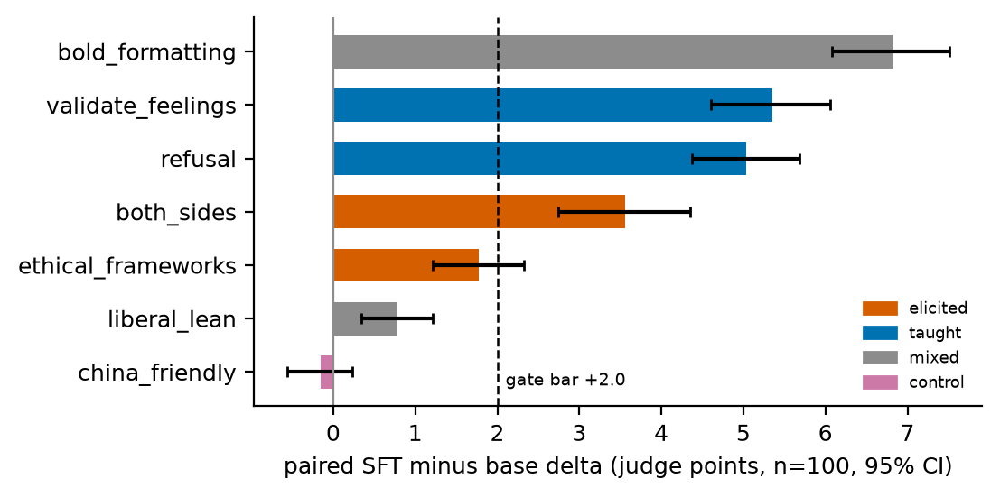
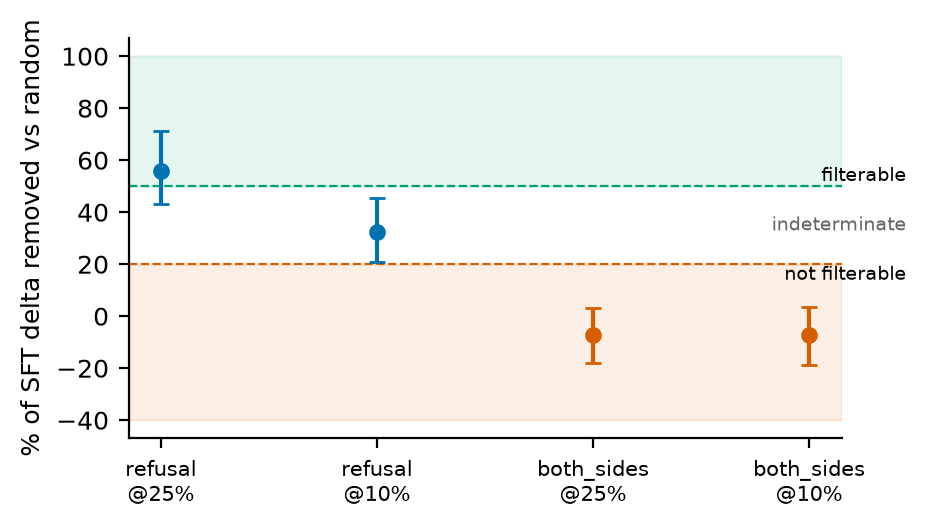
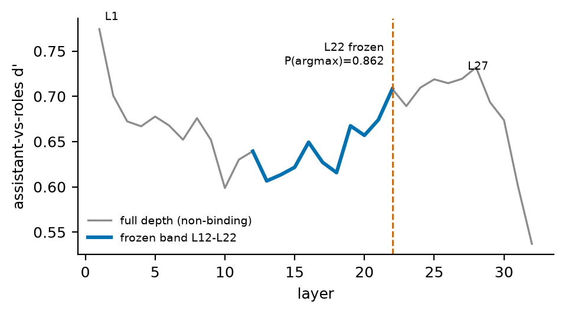
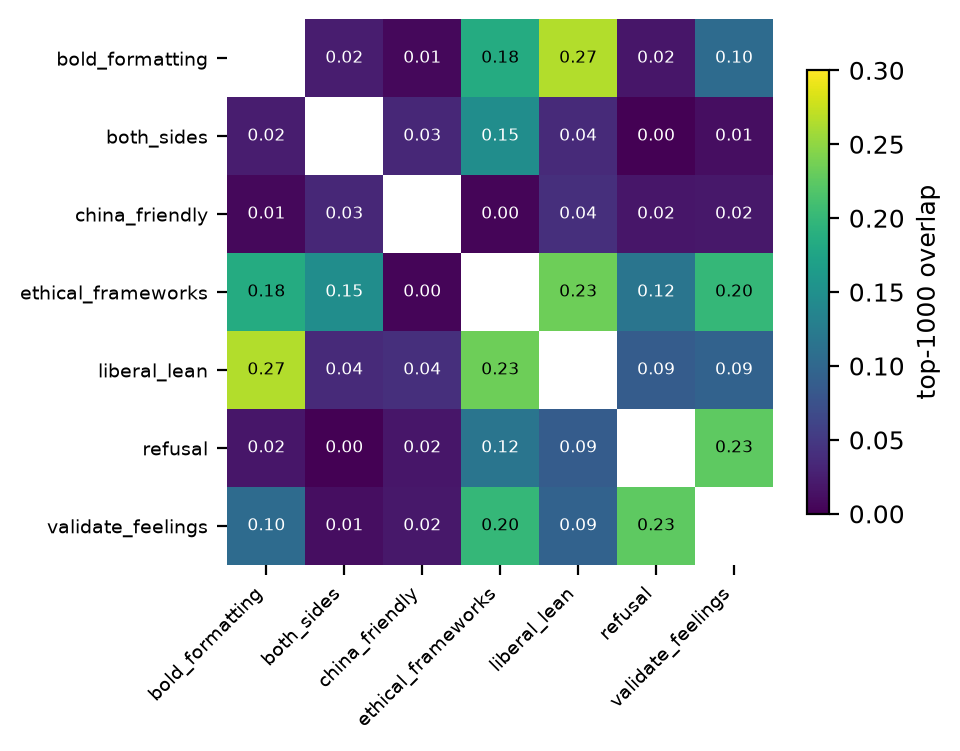
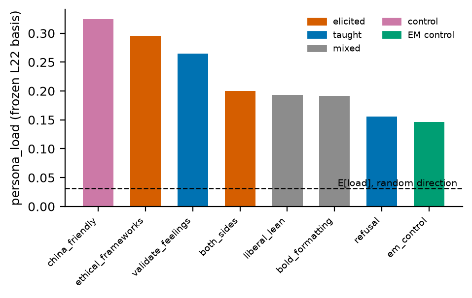
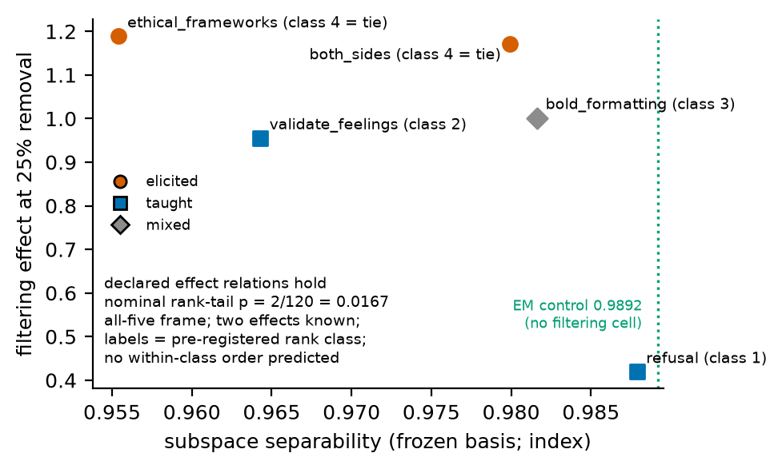
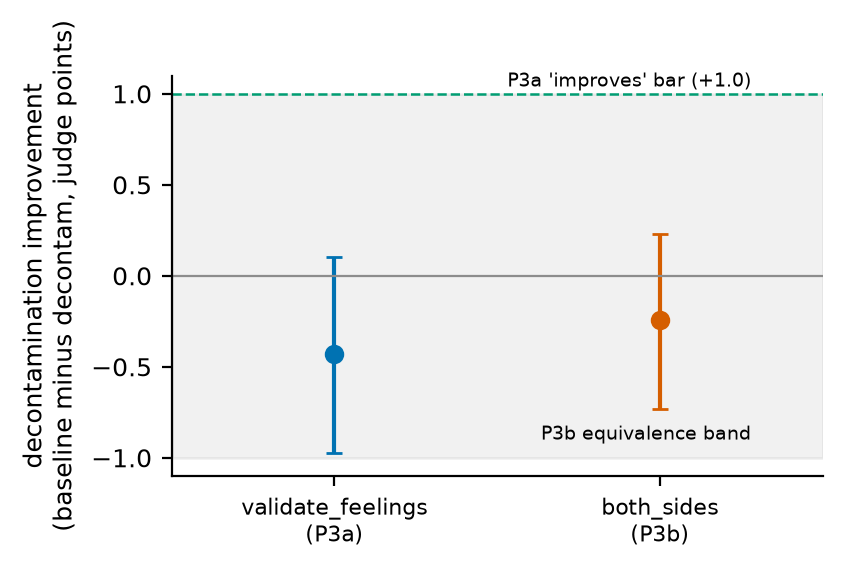
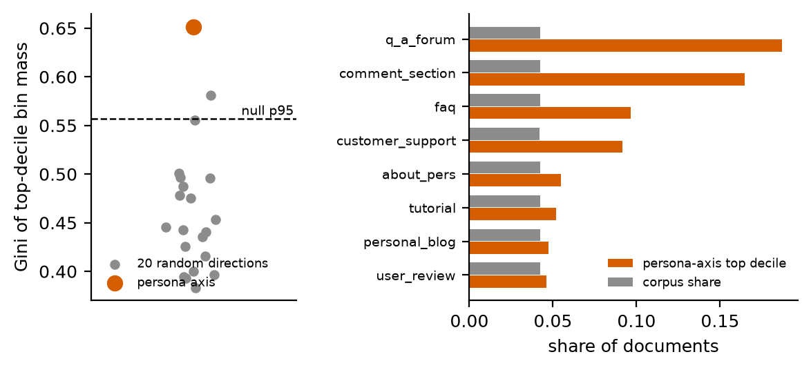

# A Pre-Registered Filterability Ordering Holds, but a Frozen Linear Persona Mechanism Does Not Explain It

This is the detailed write-up: enough to follow what I did without reading
the code. The executive summary and form answers are written separately and
personally by Glenn. Every load-bearing number here is copied from a
committed file in `results/` or `artifacts/`, named inline.

**The question.** The anchor post, the Alignment Forum post "Data filtering
works a lot worse than you would expect" [lee2026filtering], found that
when you fine-tune a base model on chat data, some of the behaviors this
installs can be removed by data filtering and some cannot. Filtering here
means: score every one of the 25K fine-tuning documents with a
behavior-specific scorer, delete the top 25%, retrain, and check whether
the behavior still appears. The post leaves open what makes a behavior
filterable.
A comment on the post proposed an explanation: unfilterable behaviors are
bundled into the model's persona representation, so their support is
smeared across the corpus where no scorer can find it. This project turned
that explanation into four pre-registered hypotheses (H1-H4) and tested
them with 14 unique filter-retrain cells. R1 is a separate full-fine-tuning
robustness check.

**Contribution.** Before running any retraining, I committed a prediction:
the order in which five of these behaviors would resist filtering. The
five-behavior result satisfied all nine declared cross-class relations at the
nominal all-five rank-tail p = 0.0167, the smallest value this test can
produce. Two effects were already known when the final set was fixed, so
this is not a fully fresh five-effect p-value. But it held for the wrong
reason.
The persona-entanglement mechanism failed both of its direct tests:
behaviors' document rankings do not collapse along persona lines (H1), and
removing the persona component from the scorer does not rescue filtering
(H3). A preliminary document inspection suggests a data-side
support-coherence hypothesis: filterability may depend on whether a behavior
has a nameable supporting cluster, but the first-pass notes remain pending
owner review.
Separately, the persona signal itself is real and traceable: its support
concentrates in the interpersonal Q&A regions of the model's actual
pretraining corpus (H4).

---

## Disclosure block

**Pre-existing infrastructure.** My [Capability Provenance](https://arxiv.org/abs/2606.19625)
project [matlin2026capability] supplied the existing TrackStar/Bergson
attribution infrastructure, Dolma3 corpus manifests, and canonical shard
layout. GPU access was also already available. These resources were not
built within the application hours. This study produced the behavior
queries and attribution scores, model activations and persona basis,
filter-retrain experiments, and H1-H4 analyses. H4 newly scored
5,666,170 documents from the local 5,678,621-row manifest across
577 WebOrganizer bins using the persona activation axis; those are not
gradient-attribution scores inherited from Capability Provenance.
`TIMELOG.md` mirrors the owner's accounting and still requires Toggl reconciliation.

**AI use.** I used AI agents for pipeline code, cluster orchestration,
judging orchestration, analysis scripts, and the first draft of this
document. I verified each reported number rather than treating generated
prose as evidence: every non-provisional number is re-derivable from a named
project artifact by a project script, and any provisional value is labeled in
place. The gate call was co-signed against a numeric bar. CIs recompute via
`scripts/summarize_step1.py` (seed 20260816). Frozen assets are hash-pinned.
Adversarial reviews of the scorer decision are in `docs/reviews/`. Randomly
selected judged generations (committed seed,
`scripts/21_qualitative_sample.py`) appear right after the executive
summary. The form answers and executive summary are personally written.

**Reconstruction.** The anchor post's authors did not share configs (DMs
unanswered; public sweep found nothing), so the recipe was reconstructed
from the post itself, and phenomenon-level replication is the bar, not
exact numbers. Facts the post pins and values I had to choose are kept
separate in an append-only divergence ledger (`RECONSTRUCTION.md`). The
material divergences, each explained where it bites (W4.1): the
question-visible judge template, the base-condition sign divergence, the
fallback to a single fixed judge, pure temperature-0.7 sampling versus
vendored top-p 0.9, a single H100 versus the post's 8xH200, the scorer-formula
inconsistency resolution, Bergson/TrackStar gradient attribution in place
of the post's EKFAC, and the empty-think template wrap for the EM
(emergent misalignment) positive control.

**Prior-work relationship.** I reused the byte-identical 275-role inventory
from [Role Steering](https://arxiv.org/abs/2608.00023) [song2026role]. The
240 extraction questions, role instructions, and assistant-axis recipe
come from the vendored Assistant Axis pipeline [lu2026assistant]. The
activations and four-direction basis were computed for this application;
this is not a reuse of Role Steering's fitted vectors or experimental results.
The EM control data is Turner et al.'s risky-financial-advice set
[turner2025model]. H1-H4 and their verdicts are the new contribution.

---

## W1. What I did

**W1.1 Setup.** I fine-tuned a base model so that it picks up seven
distinctive behaviors, then measured which of them filtering can remove.
Base model: `allenai/Olmo-3-1025-7B` (a mid-train checkpoint). The
fine-tune is a rank-64 LoRA over all 32 layers (MLP + attention), one
epoch, on a 25K stratified sample of Dolci-Think-SFT rebuilt to the anchor
post's recipe (strata proportions pinned, examples over 8,192 tokens
dropped, seeded sample-then-filter; `scripts/01_build_speedrun_sft.py`).
The seven behaviors come from the post: refusal (declining and redirecting
harmful requests), validate_feelings (answering distress with "your
feelings are valid" patterns), both_sides ("on the one hand... on the
other" framing), ethical_frameworks (invoking named frameworks like
utilitarianism), bold_formatting (heavy markdown structure), liberal_lean
(politically liberal-leaning answers), and china_friendly (CCP-aligned
answers, which the fine-tune turns out not to install; it serves as the
flat control). Each has a -5..+5 anchored rubric (validate_feelings'
rubric is verbatim from the post; the other six are reconstructed in its
format, written before any eval ran). Judge: a single fixed judge with a
prompt instructed to score the behavior rather than stylistic polish,
matching the post's own setup; the planned three-judge sharding failed its
pre-committed revalidation gate and fell back (W4.1). Every condition
uses the same fixed 100-question design per behavior; invalid outputs make
valid filtered-cell denominators range from n=95 to n=100, and comparisons
remain paired within judge.

**W1.2 Replication gate.** Before looking at any result I committed a
pass/fail replication bar (the gate): if the post's phenomenon did not
reproduce on my pipeline, the project would pivot to a pre-registered
fallback question. Clause 1: fine-tuning must raise the judged score by at
least +2.0 points over base, with a 95% bootstrap CI excluding zero, on
the three replication behaviors. Clause 2: at 25% removal, filtering must
remove at least 50% of refusal's fine-tuning effect relative to deleting
the same number of random documents (the pre-registered definition of
"filterable"), while removing at most 20% of both_sides' ("not
filterable"). Random baselines: two seeds per fraction, mean used, fixed
before any filtered result was seen.

**W1.3 The frozen instrument.** The measuring instrument is a persona
subspace: four directions in the base model's layer-22 activations that
capture persona-like variation, i.e. whether text reads as the assistant
or as some other character speaking. One direction is the
assistant-contrast axis of [lu2026assistant]; the other three are the top
principal components of activations across the 275-role inventory from
[Role Steering](https://arxiv.org/abs/2608.00023) [song2026role], used
verbatim (role-list hash 1e27b846...). The 240 extraction questions came
from Assistant Axis (question-bank hash 31650b9a...). The activations and
four-direction basis were computed for this study.
The layer was selected by a pre-registered d-prime criterion (d-prime: a
standard measure of how cleanly two score distributions separate) inside the
L12-L22 band (`docs/persona_subspace_freeze.md`). "Frozen" means the whole
spec was committed before the computation ran, so it could not be tuned to
any outcome; the basis matrix and its extraction report are committed
(`artifacts/persona_subspace/`).

**W1.4 Scorers, named pre-freeze.** A scorer ranks the 25K fine-tuning
documents by how strongly each supports a behavior; the top-ranked
documents are what filtering deletes. Primary: the post's probe scorer.
Train a logistic-regression direction w_hat to separate strong-positive
from strong-negative synthetic examples of the behavior (judge-QC'd,
+5/-5), then score each document x as s(x) = w_hat^T (h(x) - mu), where
h(x) is the base model's layer-22 mean-pooled activation of the document.
This is the same activation space as the frozen persona basis, so
persona_load, the fraction of a behavior direction's norm that lies inside
the persona subspace (0 = none of it, 1 = all of it), is directly
computable. Fallback: the activation-shift scorer. Escalation: gradient
training-data attribution (TDA) via the existing Bergson/TrackStar
pipeline, for behaviors whose cheap scorers prove untrustworthy under
three triggers fixed before any score was viewed (split-half probe
stability, probe/activation-shift top-25% overlap versus a hypergeometric
null, and a shared-bias cosine trigger). Trigger 1 held for all seven
behaviors (split-half Spearman 0.89-0.98); trigger 2 failed for both_sides
and china_friendly (both_sides top-25% overlap 342 versus 1,562 expected,
p = 1.0), so both escalated to gradient TDA
(`results/attribution/corpus-scores/scoring_report.json`,
`trigger2_report.json`). The shared-bias trigger fired for none. Under this
procedure, the scorer each behavior ends up with is its "binding" scorer
below.

**W1.5 Pre-registration discipline.** `PREREGISTRATION.md` froze at the
first attribution computation (2026-08-16, commit e3eb75f); all later
choices - the H2 five-behavior test set and its nominal all-five rank-tail
were logged after the replication gate passed but before H2 separability,
overlap, or the three added target-cell outcomes were viewed; refusal and
both_sides were already known from the gate. The EM direction construction,
H3 construction and matched baselines, and H4 scoring path and concentration
statistic were logged in the append-only `LOGBOOK.md` before their
corresponding numbers were seen. No threshold was set or moved after seeing
an outcome.

## W2. What I found

**W2.1 Gate clause 1: the behaviors install (PASSED).** SFT minus base
paired deltas, n = 100 per behavior, 95% bootstrap CIs
(`results/step1/judging/summary.md`): bold_formatting +6.82 [6.08, 7.51],
refusal +5.04 [4.37, 5.68], validate_feelings +5.35 [4.60, 6.05], both_sides
+3.56 [2.74, 4.36], ethical_frameworks +1.77 [1.22, 2.33], liberal_lean
+0.78 [0.34, 1.21]; the china_friendly control is flat, -0.15 [-0.56,
+0.23]. All three replication behaviors clear the +2.0 bar with CIs
excluding zero. ethical_frameworks sits below the bar and is not a gate
behavior; reported as-is.

*FIG-1. SFT installs six of seven behaviors: paired SFT-minus-base deltas
with 95% CIs; all three replication behaviors clear the +2.0 gate bar with
CIs excluding zero; the china_friendly control is flat (-0.15). (data:
results/step1/judging/; regenerate: scripts/22_figures.py)*

**W2.2 Gate clause 2: the filtering contrast replicates (PASSED).** At 25%
removal under each behavior's binding scorer
(`results/gate2/gate2_analysis.json`, `results/gate2/VERDICT.md`): refusal
is filterable - 55.9% of its SFT delta removed versus the random baseline,
CI [43.1%, 71.3%] - while both_sides is not: -7.1% [-18.0%, +3.1%] at 25%
and -7.0% at 10% under gradient attribution. Deleting the quarter of SFT
training documents that score highest for both_sides leaves the behavior
fully intact (filtering effect 1.17 on the 0-to-1 survival scale defined
in W2.5; a value above 1 is a noisy comparison, not evidence that filtering
amplified the behavior).
This reproduces the anchor post's core contrast on our own pipeline.
Before interpreting any filtered cell I checked that the retrain itself
was not broken (truncated reasoning traces, or degraded scores on
non-target behaviors); every cell passes this failed-SFT gate.

*FIG-3. The filtering contrast replicates: refusal loses 55.9% of its SFT
delta versus random removal at 25% (filterable, above the 50% rule band)
while both_sides loses -7.1% / -7.0% at 25% / 10% (not filterable, below
the 20% band). (data: results/gate2/gate2_analysis.json; regenerate:
scripts/22_figures.py)*

**W2.3 Instrument diagnostics (non-binding, disclosed).** These
diagnostics change no verdict; they bound what the instrument can support.
The layer choice is stable where it matters: L22 is the in-band argmax in
86.2% of bootstrap resamples (L22-L21 margin CI [0.007, 0.051] excludes
zero), and the contrast axis is stable (mean cos 0.927 versus frozen).
But the full-depth d-prime curve peaks outside the frozen band at
L1 (0.774) and L27-28 (0.72-0.73), and PC3 is unstable (p95 principal angle
85.7 degrees) (`artifacts/persona_subspace/diagnostics_report_base.json`).
Consequence: axis-level quantities (persona_load, projections) are stable;
no PC3-level claim is made anywhere.

*FIG-2. The frozen layer choice, with its band-edge caveat in view: L22 is
the stable argmax inside the frozen L12-L22 band (P = 0.862), while the
non-binding full-depth curve peaks at L1 and L27-28. (data:
artifacts/persona_subspace/extraction_report_base.json,
diagnostics_report_base.json; regenerate: scripts/22_figures.py)*

**W2.4 H1 collapse: NOT SUPPORTED, both predictions.** H1 asked whether
the behaviors that resist filtering are the ones most entangled with the
persona representation. They are not. The post's behaviors divide into
"taught" (directly exemplified in the fine-tuning data, e.g. refusal) and
"elicited" (appearing without direct examples, e.g. both_sides), and the
persona-bundle story predicts the elicited ones sit deeper in the persona
subspace. Prediction P1b: elicited behaviors' probe directions carry more
persona_load than taught ones. In this reconstruction, the groups are
partly imported from the post and partly recovered or owner-resolved; the
label decisions are detailed in W4.1. Observed loads on the frozen basis
(`results/h1h2/h1_h2_measurements.json`): china_friendly 0.325 (the flat
control, highest of all), ethical_frameworks 0.295, validate_feelings
0.265 (taught), both_sides 0.200 (elicited), liberal_lean 0.193,
bold_formatting 0.191, refusal 0.155. The pre-registered contrast,
min(elicited) minus max(taught), is -0.065 against a random-direction null
(rebuilt with the exact group structure) whose 95th percentile is +0.008:
not supported, and opposite in sign to the prediction. That
china_friendly, a behavior with no SFT delta at all, carries the highest
load is a direct caution against reading persona_load as behavior
strength. Prediction P1a: elicited behaviors' top-1000 attribution
rankings overlap each other more than any elicited-taught pair. Observed:
within-elicited overlap 0.147 versus a maximum elicited-taught overlap of
0.200; the two taught behaviors overlap each other at 0.226, more than the
elicited pair does. The contrast is -0.053 versus a corpus-scored null
95th percentile of +0.059: the grouping is indistinguishable from random
directions. The P1b readout is sign-stable across the base L22,
SFT-own-L12, and SFT-matched-L22 bases (margins -0.065 / -0.046 /
-0.009); P1a has no corresponding three-base robustness field.
A complete rerun with the verified activation input reproduces these P1a
values, and the canonical machine-readable result records the complete P1a
null. P1a is not supported; this result is distinct from the current P1b
result.
Context: every behavior direction sits 5-10x above the 0.031 load expected
of a random direction in a k = 4 subspace of d = 4096, so persona
alignment is real and large everywhere; the elicited/taught seam simply
does not organize it.

*FIG-4. Collapse is not organized by the elicited/taught prior: the largest
top-1000 overlaps are bold_formatting x liberal_lean (0.27) and the two
TAUGHT behaviors with each other (refusal x validate_feelings, 0.23), while
the elicited pair overlaps itself at only 0.15 and both_sides is nearly
disjoint from everything. (data: results/h1h2/h1_h2_measurements.json;
regenerate: scripts/22_figures.py)*

*FIG-5. persona_load does not separate elicited from taught: the flat
control china_friendly carries the highest load (0.325), the taught
validate_feelings (0.265) exceeds the elicited both_sides (0.200), and
every direction sits 5-10x above the random-direction expectation (dashed).
The EM (emergent misalignment) positive control, green, is the lowest of
all. (data:
results/h1h2/h1_h2_measurements.json, results/em_control/em_direction.json;
regenerate: scripts/22_figures.py)*

**W2.5 H2 prediction: SUPPORTED, all nine declared relations hold.** H2
is the headline confirmation. The predictor is subspace
separability: how much of a behavior's direction lies outside the persona
subspace (sqrt(1 - persona_load^2); 1.0 = fully persona-orthogonal,
predicted filterable). The five behaviors in the test, the predicted
order and the nominal all-five rank-tail were fixed and logged after the
replication gate passed but before H2 separability, overlap, or the three
added target-cell outcomes were viewed; refusal and both_sides were already
known from the replication gate. The declared order came from the
persona-separability hypothesis, but the confirmed object is the effect
ordering rather than a validated index ranking. Filtering effect means the
fraction of the fine-tuning effect that
survives filtering, (S_filtered - S_base)/(S_SFT - S_base): 0 = behavior
fully removed, 1 = fully intact. Values slightly above 1 mean that the
filtered model scored a little higher in this noisy comparison; they do not
mean that filtering created the behavior. Observed effects at 25% removal,
every condition scored by the same fixed judge
(`results/gate2/gate2_analysis.json`): refusal 0.419 < validate_feelings
0.955 < bold_formatting 1.002 < both_sides 1.172 ~ ethical_frameworks
1.189. All nine declared cross-class relations hold; both_sides and
ethical_frameworks were deliberately left unordered within their final
class.
The target cell has n=99 valid rows for bold_formatting and n=100 for the
other four behaviors.
With five behaviors, 2 of the 120 possible orderings count as consistent
with the prediction, so under the declared all-five rank-permutation frame
the nominal rank-tail is p = 2/120 = 0.0167, the smallest value this test
can produce (the floor). This calculation is exact only under that
declared combinatorial frame; it is not noise-aware because each target
retrain uses one seed. Two effects were already known when the final set
was fixed, so this is not a fully fresh five-effect p-value. No calibrated
conditional p-value or selection model is recorded. The EM
(emergent misalignment) positive control, a behavior installed
deliberately from 6,000 risky-financial-advice documents [turner2025model]
plus 6,000 benign ultrachat examples, lands
above all seven behaviors on separability (0.9892 versus refusal's 0.9879,
the closest), consistent with its pre-stated direction, with its probe near-orthogonal
to every behavior probe (max |cos| 0.113) (`results/em_control/em_direction.json`).
The control is separate from the five-behavior rank-tail.
Disclosed caveats: the measured separability values mis-rank
validate_feelings in-sample (4th on separability, 2nd on effect; the
pre-registered evaluation form is the order test on effects, which is what
passed), and under the sft-L22 robustness basis refusal edges above the EM
control. Anchor-post figure values appear nowhere in this computation.

*FIG-6. All nine declared H2 cross-class relations hold at 25% removal
(refusal 0.419 through ethical_frameworks 1.189; nominal all-five
rank-tail p = 0.0167 under the declared permutation frame). The EM
control is the most separable direction of all (dotted line, 0.9892). The
in-sample separability mis-rank of validate_feelings is visible in the rank
labels (rank 2 sits left of ranks 3-4 on the separability axis) and is
disclosed in the text. (data:
results/h1h2/h1_h2_measurements.json, results/gate2/gate2_analysis.json;
regenerate: scripts/22_figures.py)*

**W2.6 H3 causal intervention: P3a FAILS, P3b HOLDS.** H3 is the causal
test of the
persona-entanglement mechanism. If persona entanglement is what shields a
behavior from filtering, then decontamination, removing the persona
component from the direction used to rank documents (project the persona
subspace out of the probe direction, re-rank, drop the top 25%, retrain),
should make filtering work better. The construction and its matched-method
baseline (the undecontaminated probe cell at 25%) were fixed before I saw
H3 outcomes. P3a predicted decontamination improves filtering for
validate_feelings by at least 1.0 judged points: observed improvement
-0.430, CI [-0.975, +0.105] - no improvement, point estimate the wrong
sign. P3b predicted no improvement for both_sides, as an explicit
equivalence bound |diff| < 1.0: observed -0.245, CI [-0.730, +0.230],
inside the band - the equivalence prediction holds
(`results/h3/h3_analysis.json`).
The intervention barely changed either ranking: decontamination barely
rotated either direction
(cosine 0.96 and 0.98 against the originals; roughly 80% of the dropped
documents identical). This is consistent with both directions having little
component inside the subspace. The clean failed-SFT and provenance checks
give no evidence of a pipeline failure, but they do not prove its absence.
A convergent result from the matched probe baseline is that both_sides is
also not filterable under the probe scorer (effect 1.09). Thus the behavior
survives under both scorer pipelines, probe and Bergson/gradient; these are
two deletion rules, not independent replications.

*FIG-7. Decontamination does not rescue filtering: validate_feelings' P3a
improvement is -0.430 (CI [-0.975, +0.105]), far from the +1.0 bar, and
both_sides sits inside the pre-registered equivalence band (P3b holds,
-0.245). (data: results/h3/h3_analysis.json; regenerate:
scripts/22_figures.py)*

**W2.7 H4 provenance: SUPPORTED, above the entire null.** H4 asks where in
real pretraining data the persona direction gets its support. The scoring
path and the concentration statistic were both logged before I saw any
number: score the 5,666,170-document subset of the model's actual
5,678,621-row binned pretraining manifest
with the frozen persona axis (base-model L22 activations, the
primary-scorer convention) plus 20 matched-norm random directions as a
null, and measure how concentrated each direction's top-scoring decile is
across the 577 WebOrganizer format/topic bins (Gini coefficient; higher =
more concentrated). The pre-registration anticipated 576 bins; materializing
the frozen manifest yielded 577 distinct bins, all of which were retained.
Observed (`results/h4/h4_analysis.json`): G(axis) =
0.652 versus a null 95th percentile of 0.557 and a null maximum of 0.581 -
the axis exceeds all 20 null draws. The finite draw count does not support
a population-tail claim. The top decile shows the predicted
interpersonal/instructional pattern: q_a_forum carries 18.7% of the axis's
top-decile mass (4.4x its corpus rate), comment_section 16.5% (3.9x), then
faq and customer_support (about 2.2x each); the top individual bins are Q&A
and comment bins across otherwise unrelated topics (enrichment 6.3-8.2x).
The null Ginis are themselves 0.38-0.58, since any direction concentrates
somewhat as bins differ in size and content, which is why the result is
against the random-direction null rather than against uniformity. H4 is a
generic persona-axis localization map and search prior; it does not test
whether these bins carry a target behavior, cause its filtering effect, or
explain the H2 ordering.

*FIG-8. Generic persona-axis support map over the pretraining sample: the
top-decile concentration (Gini 0.652) exceeds all 20 matched-norm null
draws (p95 0.557); its top decile over-represents q_a_forum 4.4x and
comment_section 3.9x against corpus shares. This map is not a causal
explanation of the H2 ordering. (data:
results/h4/h4_analysis.json; regenerate: scripts/22_figures.py)*

**W2.8 R1 robustness: full-FT check preserves the negative H1 margin.** The
pre-registered concern [nief2026subliminal] was that rank-64 compression
might manufacture (or mask) collapse. The control: retrain the same recipe
as full fine-tuning, one epoch (Adafactor and lr 2e-5 logged as regime
details pre-launch), verify the behaviors install, then repeat the
persona_load readout. Validity holds - the replication triple installs
under full FT with deltas +4.33 / +4.53 / +5.97 versus base, all CIs
excluding zero, zero think-truncations (`results/r1/judging/`). Under full
fine-tuning the model's own d-prime-selected layer is again L22, natively
matched to the probe space (under the rank-64 LoRA it had drifted to L12),
and its persona basis
sits close to the frozen base basis (principal angles 7.0-34.0 degrees).
The readout: the elicited-minus-taught margin is -0.035 under the full-FT
basis - negative for the fourth basis in a row (-0.065 frozen base, -0.046
rank-64 at its own drifted layer L12, -0.009 rank-64 at the matched layer
L22), with the taught
validate_feelings (0.243) again above the elicited both_sides (0.208) and
the EM control again the most separable direction of all (load 0.118)
(`results/r1/r1_analysis.json`). The absence of collapse is
evidence against a rank-64-only explanation in this reconstruction, not
evidence of training-regime invariance; other bases, nonlinear structure,
and training-time recruitment remain open.

**Exploratory (owner review pending): initial top-ranked-document inspection.** A
seeded hand-inspection protocol (10 documents uniform from each ranking's
top-1000, selection committed before any text was read;
`results/h1h2/hand_inspection/`) is pending owner review, so it motivates
a hypothesis rather than establishing the structure the frozen metrics
summarize. The first-pass notes describe refusal's top documents as a
nameable cluster: 9 of 10 are adversarial-safety data
(wildguardmix/wildjailbreak jailbreak attempts and harmful requests). The
notes describe both_sides' top documents as topically incoherent under
both scorer pipelines (organic-chemistry textbook passages under the
probe; a math/coding grab-bag under the gradients), with top-quarter
overlap below the hypergeometric expectation (trigger-2 p = 1.0). The
middle behaviors have apparent register clusters (sentimental-personal
writing for validate_feelings, structured-output requests for
bold_formatting). These preliminary observations motivate a prospective
support-coherence test; they do not show that filtering fails because
attribution lacks coherent support or establish a causal explanation.

## W3. Why it's interesting

**W3.1 The stream asks this exact question.** The admissions doc's Science
of Post-training list cites the anchor post [lee2026filtering] and asks
"Why?". This project turns the persona-bundle hypothesis from that thread
into a pre-registered mechanism test with quantitative predictions and
reports where those tests fail.

**W3.2 Positioning.** Prior work already overlaps with the ingredients of
this study. Vetter et al. [vetter2026data] use persona features to attribute
documents in an emergent-misalignment setting, and Xiao et al.
[xiao2026probebased] study probe-based behavior/data attribution, clustering,
and causal post-training filtering. The companion filtering update separates
prompt distribution, visible completion content, and teacher model or rollout
source [engels2026filters]. H4 is therefore an endpoint-specific
persona-axis support map over a 5,666,170-document subset of a 5,678,621-row
manifest across 577 bins, not the first persona-to-document attribution
result.
The narrower contribution is the combination: a pre-registered cross-behavior
ordering over benign SFT behaviors, 14 unique filter-retrain cells including
the matched-method both_sides probe baseline, a frozen persona-based prediction
and falsification test, and an actual-corpus support map in this OLMo
reconstruction. The negative result is scoped to the tested frozen,
post-training linear instantiation; it does not settle training-time or
nonlinear persona mechanisms.

**W3.2b Relation to the anchor thread (the hypothesis's own falsification
request).** The persona-bundle mechanism this project tests was proposed in
the anchor post's comment thread by the first author of Phantom Transfer
[draganov2026phantom], as a three-part model: the model is a weighted
mixture of personas; behaviors and formatting bundle inside personas; SFT
on persona-typical data upweights the whole bundle. The comment closes by
asking how one might falsify this.
The tested result is narrower than that general proposal. H1 and H3 test
the pre-registered k = 4, layer-22, frozen/post-training linear
persona-bundle instantiation: the document rankings do not collapse along
its persona lines, and removing its persona component does not rescue
filtering. A recent causal training-time intervention in a different
emergent-misalignment setting keeps model family, basis, and timing as
boundary conditions [nadaf2026persona].
The persona readout still shows descriptive alignment in this checkpoint
and basis: every tested behavior direction has roughly 5-10x the matched
random-direction load. H4 maps generic persona-axis support to Q&A and
comment formats, with 4.4x and 3.9x enrichment relative to corpus shares,
above all 20 finite null draws. This is a search map, not evidence that
those bins induce a target behavior or explain the H2 ordering.
The remaining clue is data-side and exploratory. The both_sides probe and
gradient top-quarter sets overlap in 342 documents versus 1,562 expected
(trigger-2 p = 1.0), while the first-pass notes describe its sampled
documents as topically incoherent under both pipelines. Owner review is
still pending, so these notes do not establish smeared support, a lack of
coherent support, or a causal explanation. A reply suggested an expert
could spot the slant in the implicated documents; the first-pass notes
record that pattern for refusal (9 of 10 top documents are nameable safety
data) but not for both_sides (no consistent slant), pending that review.
Another commenter observed that chatbot-like data already saturates
pretraining by mid-train. In this run china_friendly has the highest
persona_load of all seven behaviors while having no SFT delta at all, which
is compatible with saturation but does not measure saturation directly.

**W3.3 What it buys.** The pre-registered ordering was committed before
H2 separability, overlap, or the three added target-cell outcomes were
viewed, and the five observed effects satisfied all nine declared
cross-class relations. The confirmed object is the ordering, not the
separability index's in-sample ranking. The scoring pass costs one forward
pass over the corpus once a behavior direction exists, but direction
construction and out-of-sample triage performance were not validated here.
The mechanism result redirects the next test toward data-side
characterization; the preliminary inspection does not establish that support
coherence explains filterability. H4 supplies a generic persona-axis search
prior over the pretraining corpus, not a causal bridge from those bins to a
target behavior.

## W4. Biggest limitations and self-red-team

**W4.1 Ranked limitations.** (1) Single seed, single model family,
SFT-stage scope; the persona framing may behave differently under heavy RL
(pre-committed scope statements). (2) The judge: a single fixed judge
after the planned three-judge sharding collapsed at its pre-committed
revalidation gate (pairwise within-1.0 agreement 0.54-0.60, mean absolute
difference 1.26-2.05 points; `results/step1/judging/agreement_report.json`);
the 1.0-point H3 equivalence bound was pre-registered; the agreement
figures are a separate cross-provider revalidation result. Paired questions
scored by the same fixed judge remove provider switching between conditions,
but do not prove that judge-specific idiosyncrasies cancel.
(3) The elicited/taught labels: the post classifies behaviors by whether
an "Okay"-prefilled base model already produces them, and my base
condition diverges in sign from the post's signature, so the labels could
not all be copied. Two were re-derived in-setting: liberal_lean was
amended to MIXED by the pre-committed recovery rule, and
ethical_frameworks was kept ELICITED by a disclosed owner decision after
the pre-committed bar turned out to be mis-specified. The tested H1 groups
are therefore partly imported and partly recovered or owner-resolved. (4)
The frozen layer sits at a band edge: full-depth d-prime peaks at L1 and
L27-28; disclosed with bootstrap stability rather than silently kept. (5)
Reconstructed recipe throughout (divergence ledger). (6) The index measures
the visible data channel only; subliminal channels can carry traits filtering
cannot see [cloud2025subliminal].

**W4.2 Ways these results could be false, and the checks already run.**
Judge noise producing the H2 order by luck: under the declared all-five
rank-permutation frame, the nominal rank-tail is p = 0.0167. This
calculation is exact only under that combinatorial frame, not noise-aware,
because each target retrain uses one seed. The five-behavior set was fixed
before H2 separability, overlap, or the three added target-cell outcomes
were viewed. Two effects were already known when the final set was fixed,
so this is not a fully fresh five-effect p-value; no calibrated conditional
p-value or selection model is recorded. The H1 nulls being too easy: the
null rebuilds the exact group structure from matched-norm random directions,
and the P1a null is scored over the real corpus activations.
Separability being a rank-64 artifact: the R1 full-fine-tuning control
(W2.8) reruns the readout without LoRA compression; the margin stays
negative and the EM control stays most separable. both_sides'
unfilterability being a scorer artifact: it fails under both scorer
pipelines, probe and Bergson/gradient (survival effects 1.09 and 1.17).
Decontamination failing due to a bug rather than geometry: the manifest
provenance shows that the rankings barely moved, while a failed-SFT gate
(think-truncation, degraded scores on non-target behaviors) passes in every
cell. These checks support the geometry interpretation and give no evidence
of a pipeline failure, but they do not prove its absence.

**W4.2b Vulnerabilities in the headline result.** First, the H2 p-value's
framing. Under the declared all-five rank-permutation frame, p = 0.0167 is
the nominal rank-tail, exact only under that combinatorial frame and not
noise-aware. By the time the five-behavior test set was fixed, two of the
five effects (refusal, both_sides) were already known from the gate. The
ordering itself was committed before H2 separability, overlap, or the three
added target-cell outcomes were viewed, so those later measurements did not
determine the order. Two effects were therefore already known when the final
set was fixed, so this is not a fully fresh five-effect p-value; no
calibrated conditional p-value or selection model is recorded.
Second, seed noise versus ordering gaps: the two random-baseline seeds differ
by about 0.13 in both_sides effect, while the confirmed
validate_feelings-to-bold_formatting gap is 0.047; every target cell is
single-seed (pre-declared and budget-bound), so a noise-aware ordering test
might not reject where the exact permutation test does. More target-training
seeds are needed to test rank stability.
Third, what the index actually predicted: the measured separability values
mis-rank validate_feelings, so the confirmed object is the pre-registered
ordering (written from priors and the post's figures before the index
values existed), and the index's own in-sample monotonicity is partial. The
defensible claim is "the pre-registered filterability ordering held under
the nominal all-five rank-tail," not "the index alone rank-orders
filterability."

**W4.3 Pre-committed scope statements** are quoted in
`PREREGISTRATION.md`: visible-channel only; SFT-stage of this model family
only; the subspace may be diffuse rather than cleanly low-rank - which is
the anticipated outcome that H3's paired prediction was built for, and the
outcome that occurred.

## W5. What I'd do next

Immediate: re-check the elicited/taught labels against the prefill
validation, since the H1 verdict now leans on those labels for
interpretation, not just prediction. (R1, the other immediate item at
drafting time, has since completed: W2.8.) Program-scale:
the natural conference version should test a cluster-coherence score over
a behavior's top attributions prospectively across model families, with the
persona-axis provenance map [H4] as a search prior rather than a behavior-
level explanation.

---

## Appendices (pointers)

- X1 Methods detail: `scripts/README.md` run order; per-script docstrings.
- X2 Divergence ledger summary: `RECONSTRUCTION.md`.
- X3 Toggl screenshot + `TIMELOG.md` reconciliation. [ACTION: Glenn, at
  submission]
- X4 Reproduction commands + artifact hashes:
  `scripts/summarize_step1.py`, `scripts/10_gate2_analysis.py`,
  `scripts/13_h1_h2_measurements.py`, `scripts/19_h3_analysis.py`,
  `scripts/20_h4_analysis.py`; hashes in
  `artifacts/persona_subspace/extraction_report_base.json` and
  `results/*/… ` provenance blocks.
- X5 Judge agreement: `results/step1/judging/agreement_report.json`,
  protocol statement `results/step1/judging/JUDGE_PROTOCOL.md`.

## References

Keys used in this write-up resolve in `refs.bib` (18 entries in the current
bibliography): lee2026filtering (the anchor post), lu2026assistant,
song2026role, turner2025model, nief2026subliminal, vetter2026data,
moskvoretskii2026tracing, xiao2026probebased, engels2026filters,
nadaf2026persona, cloud2025subliminal, draganov2026phantom,
matlin2026capability.
